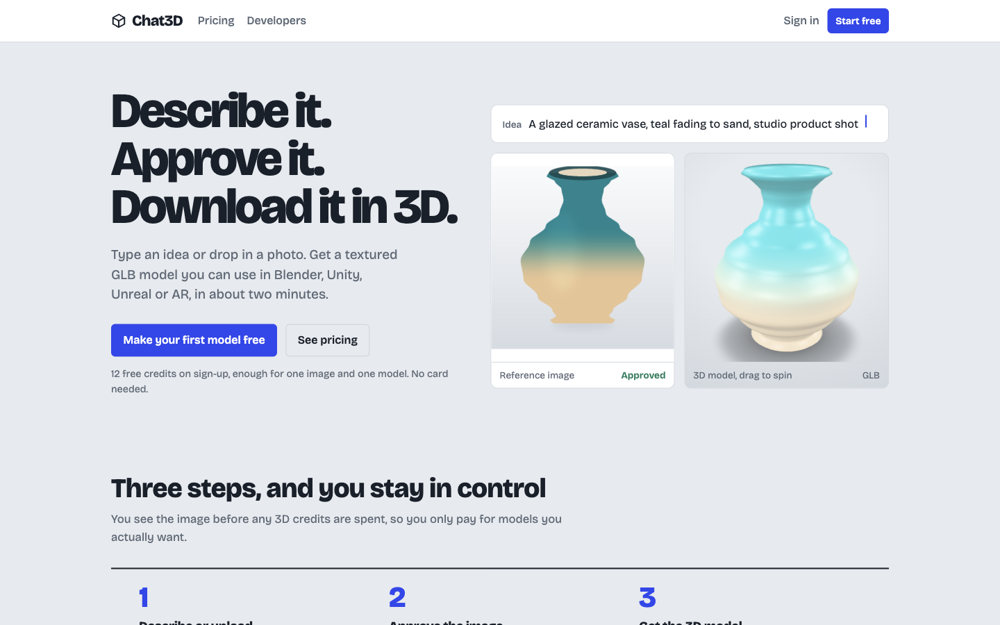
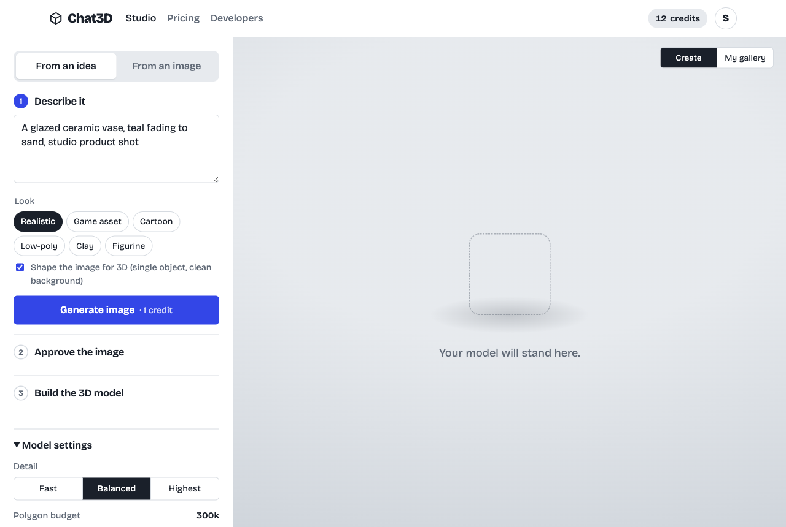
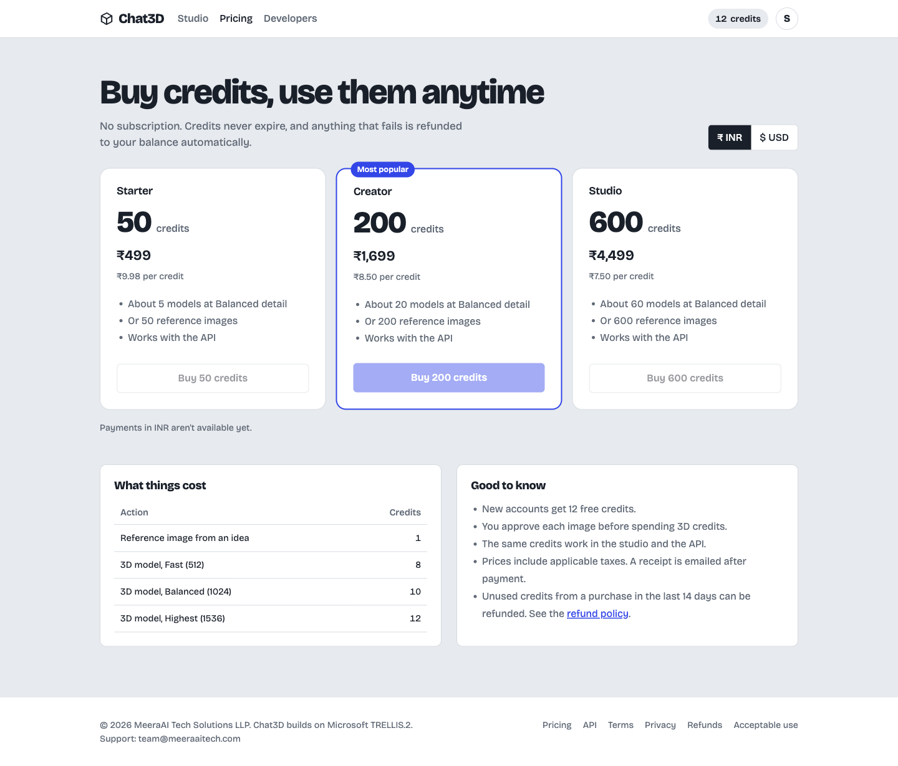
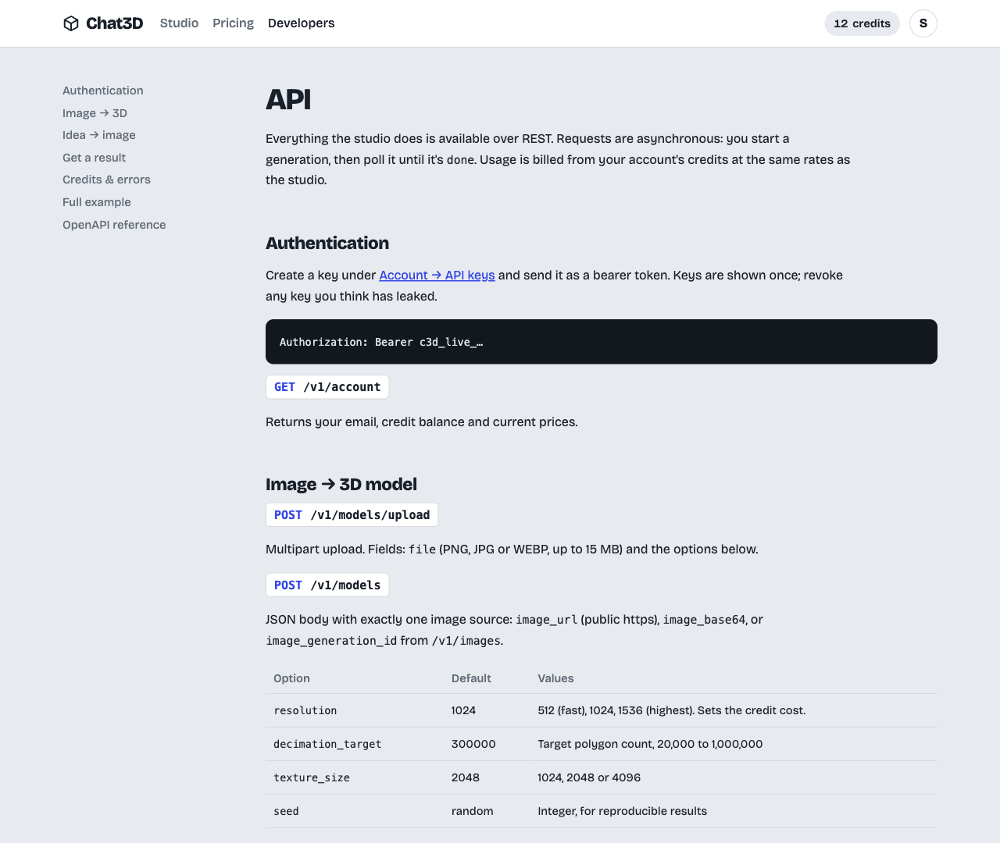
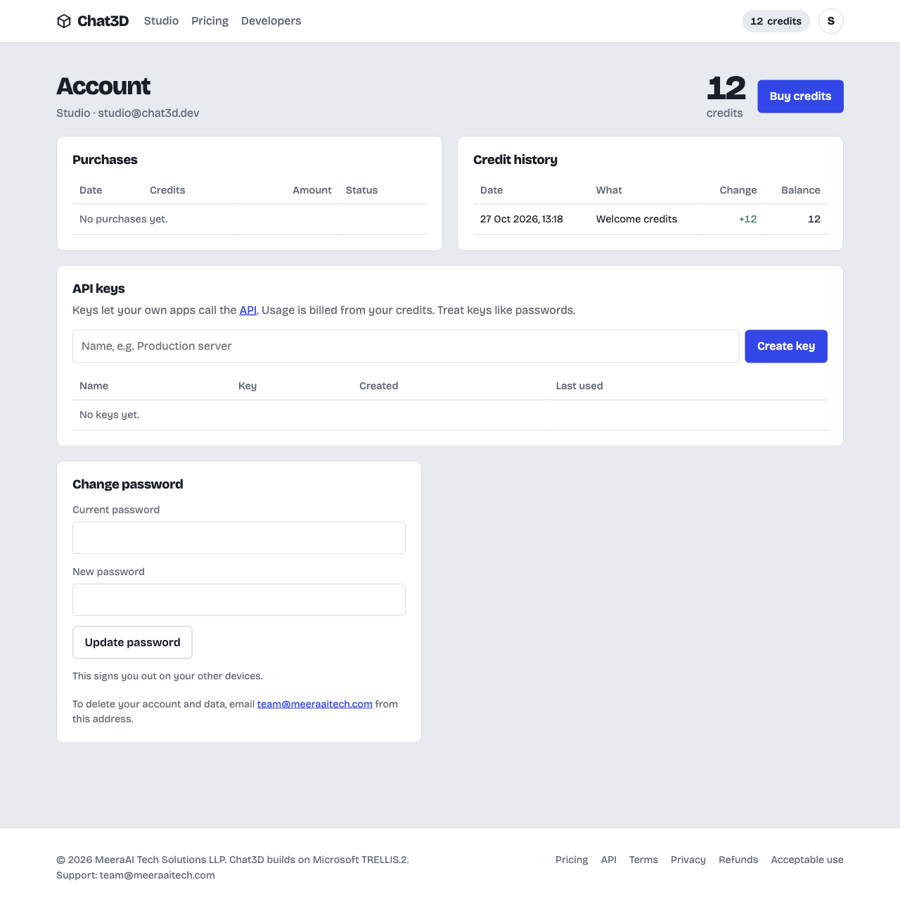
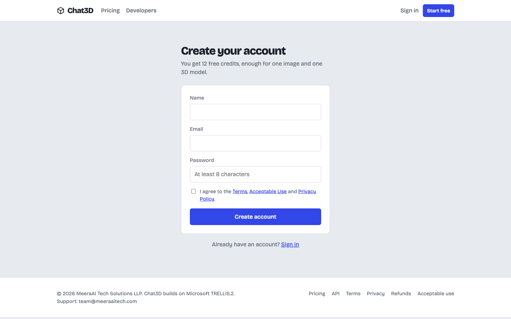
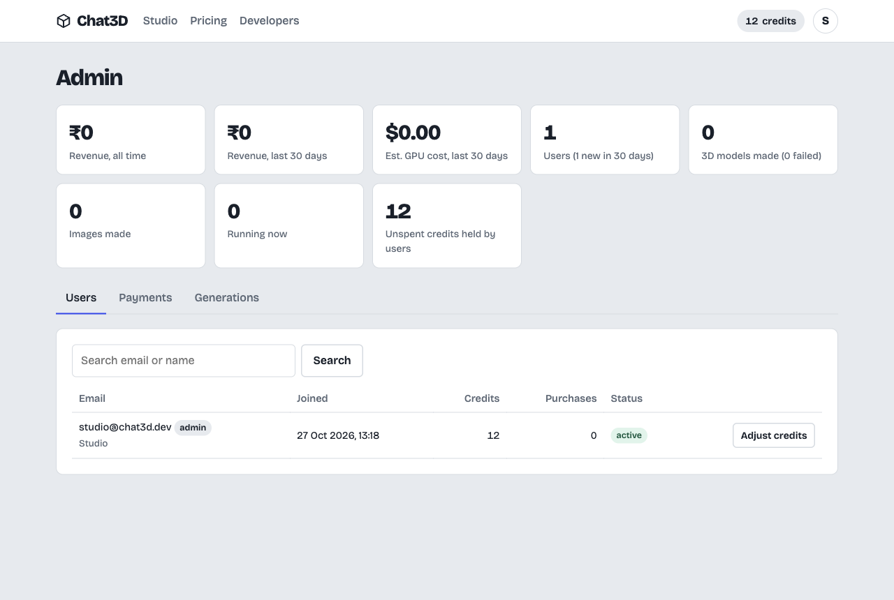
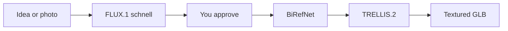

<p align="center">
  
</p>

<h1 align="center">Chat3D</h1>

<p align="center">
  Describe an object, or drop in a photo. Approve the picture. Download a textured <strong>.glb</strong> you can open in Blender, Unity, Unreal, three.js, or AR.
</p>

<p align="center">
  <a href="#studio">Studio</a> ·
  <a href="#pricing">Pricing</a> ·
  <a href="#api">API</a> ·
  <a href="#run-it">Run it</a> ·
  <a href="#go-live">Go live</a>
</p>

Chat3D is a paid idea → image → 3D service. Customers stay in control: they see the reference image **before** any 3D credits are spent. Failed jobs refund themselves. The same balance works in the browser and over a REST API.

Production models, all commercially usable:

| Step | Model | License |
|---|---|---|
| Idea → image | [FLUX.1 schnell](https://huggingface.co/black-forest-labs/FLUX.1-schnell) | Apache-2.0 |
| Background removal | [BiRefNet](https://github.com/ZhengPeng7/BiRefNet) | MIT |
| Image → 3D | [Microsoft TRELLIS.2](https://github.com/microsoft/TRELLIS.2) | MIT |

They run on [fal.ai](https://fal.ai), pay per call, so there is no GPU to babysit. The public TRELLIS.2 Hugging Face Space removes backgrounds with BRIA RMBG-2.0 (CC BY-NC 4.0, non-commercial). That is why production uses BiRefNet, and why `MESH_PROVIDER=hf_space` is refused when `ENVIRONMENT=production`.

## Studio

<p align="center">
  
</p>

Three steps, and the customer can leave at any time. Finished work lands in the gallery.

1. **Describe or upload.** A sentence, plus a look — realistic, game asset, cartoon, low-poly, clay, or figurine — or a PNG, JPG, or WEBP up to 15 MB.
2. **Approve the image.** FLUX draws a single object on a clean background, the kind of frame TRELLIS.2 reconstructs well. Another try costs 1 credit.
3. **Build the model.** Detail at 512, 1024, or 1536. Polygon budget from 20k to 1M. Textures at 1K, 2K, or 4K. Inspect it in the browser, then download the GLB.

The stage shows live progress, resumes a running job after a reload, and keeps every image and model in a filterable gallery.

## Pricing

<p align="center">
  
</p>

No subscription. Credits never expire. Anything that fails is returned to the balance automatically, and the ledger cannot go negative under concurrent jobs.

Default packs (every price is an env var):

| Pack | Credits | India | International | About this many Balanced models |
|---|---:|---:|---:|---:|
| Starter | 50 | ₹499 | $6.99 | 5 |
| Creator | 200 | ₹1,699 | $23.99 | 20 |
| Studio | 600 | ₹4,499 | $63.99 | 60 |

| Action | Credits | fal.ai cost | Revenue at the Creator pack |
|---|---:|---:|---:|
| Reference image | 1 | ~$0.003 | ₹8.50 |
| 3D, Fast (512) | 8 | $0.25 | ₹68 |
| 3D, Balanced (1024) | 10 | $0.30 | ₹85 |
| 3D, Highest (1536) | 12 | $0.35 | ₹102 |

That is roughly 2.8–3.4× GPU cost before gateway fees and GST. Razorpay covers UPI, cards, net banking, and wallets in INR. Stripe Checkout covers cards in USD. Each payment grants credits exactly once, even when the browser callback and the webhook both arrive. New accounts start with 12 free credits, enough for one image and one model, with no card.

Buy buttons stay quiet until `RAZORPAY_*` or `STRIPE_*` is set. The screenshot above is that state: the prices render, checkout waits for keys.

## API

<p align="center">
  
</p>

The studio and the API share one credit balance. Create a key under Account, then send it as `Authorization: Bearer c3d_live_…`. Keys are stored hashed and shown once.

```bash
# Image → textured GLB
curl https://your-host/v1/models/upload \
  -H "Authorization: Bearer c3d_live_…" \
  -F file=@chair.png \
  -F resolution=1024 \
  -F decimation_target=300000 \
  -F texture_size=2048

# Poll until status is "done", then download output.glb_url
curl https://your-host/v1/generations/<id> \
  -H "Authorization: Bearer c3d_live_…"
```

| Method | Path | What it does |
|---|---|---|
| `GET` | `/v1/account` | Email, balance, current prices |
| `POST` | `/v1/images` | Idea → image. Styles: `realistic`, `stylized`, `cartoon`, `lowpoly`, `clay`, `figurine` |
| `POST` | `/v1/models` | Image → GLB from a public `image_url`, `image_base64`, or an `image_generation_id` |
| `POST` | `/v1/models/upload` | The same, as multipart |
| `GET` | `/v1/generations/{id}` | `queued` → `running` → `done` or `failed`. Signed file links last one hour |

URL fetches are SSRF-safe. The public API is rate limited, and OpenAPI lives at `/api/docs`. A readable guide ships at `/developers`.

## Accounts and admin

<p align="center">
  
</p>

<p align="center">
  
</p>

Email and password (bcrypt), 30-day sessions, password reset by email, and a password change that signs out other devices. Credit history is an append-only ledger: welcome grant, purchase, spend, refund, admin adjustment.

<p align="center">
  
</p>

`/admin` is limited to `ADMIN_EMAILS`. It shows revenue next to estimated GPU spend, lists users, payments, and generations, adjusts credits, suspends accounts, refunds a single job, and marks a payment refunded after you return the money in Razorpay or Stripe.

Legal pages the gateways expect are linked in the footer: Terms, Privacy, Refund & Cancellation, and Acceptable Use. Company name, address, and support email come from `COMPANY_*`.

## Run it

```bash
git clone https://github.com/alexbieber/CHAT3D.git
cd CHAT3D
cp .env.example .env
```

**Try the whole product offline, at no cost.** In `.env`:

```bash
IMAGE_PROVIDER=mock
BG_PROVIDER=mock
MESH_PROVIDER=mock
ADMIN_EMAILS=you@example.com
```

```bash
docker compose up --build    # app + Postgres → http://localhost:8000
```

Without Docker, SQLite is the default:

```bash
pip install -r requirements.txt
uvicorn backend.app:app --port 8000
```

A banner on every page says test mode is on, and images and meshes are placeholders. Point the three providers at `fal`, set `FAL_KEY`, and the same screens call FLUX, BiRefNet, and TRELLIS.2.

```bash
pytest tests
```

Set `TEST_DATABASE_URL=postgresql+psycopg://…` to run the suite on Postgres. The tests walk signup, generation, payment fulfilment, and refunds.

The landing hero ships with a sample vase (`frontend/assets/example-vase.png` and `.glb`) so the page is alive on a fresh clone. Swap those two files for a real TRELLIS.2 render and its source image before you launch.

## What's included

| Area | What you get |
|---|---|
| Studio | Idea → image → approve or try again → 3D, or upload → 3D. Live progress, viewer, GLB download, jobs that survive a reload |
| Gallery | Every image and model, filterable, reopenable, deletable |
| Accounts | Signup, login, 30-day sessions, email reset, password change, suspend |
| Credits | Append-only ledger. Charged up front, refunded on any failure, atomic under concurrency |
| Payments | Razorpay and Stripe. Signature-checked webhooks. A payment credits the account once |
| API | Hashed keys, rate limits, SSRF-safe fetches, OpenAPI at `/api/docs` |
| Admin | Revenue, GPU estimate, users, adjustments, suspensions, payments, per-job refunds |
| Safety | Image safety filter, upload re-encoding, size limits, login and API rate limits, CSRF origin check, security headers, signed expiring file links |

## Go live

1. **fal.ai.** Create a key, add billing, set `FAL_KEY`. Generate one real model and look at it.
2. **Domain + HTTPS.** Put the app behind Caddy, Nginx, or an AWS ALB. Set `APP_URL=https://…` and `ENVIRONMENT=production`.
3. **Secrets.** `SECRET_KEY` (32+ random bytes) and a strong `POSTGRES_PASSWORD`.
4. **Storage.** On AWS, `STORAGE_BACKEND=s3` with a private bucket. The instance role needs `s3:GetObject` and `s3:PutObject` on the prefix. Local disk is fine for one box.
5. **Razorpay.** Finish KYC, set the live keys, and add the webhook `{APP_URL}/webhooks/razorpay` for `payment.captured`, `order.paid`, and `payment.failed`.
6. **Stripe.** Live key, and `{APP_URL}/webhooks/stripe` for `checkout.session.completed`.
7. **Email.** SMTP (SES, Postmark, Zoho) so receipts and password resets leave the server. Without it they are only logged.
8. **Legal.** The policy pages are a starting draft. Have a lawyer read them, especially GST invoicing, the refund window, and the DPDP wording. Company details come from `COMPANY_*`.
9. **Backups.** Daily Postgres dumps, and versioning on the bucket.
10. **Hero.** Replace `frontend/assets/example-vase.png` and `example-vase.glb` with a model you are proud of.

## How it is built



One process on purpose. Generations run in an in-process thread pool (`WORKER_THREADS=8`) because the provider calls are I/O-bound. On startup, anything left `queued` or `running` by a crash is failed and refunded. To grow past one machine, move `generations._run` onto a queue and keep the same tables.

Provider files are copied into your storage immediately, because fal URLs expire. Customers receive signed links valid for `SIGNED_URL_TTL` seconds (one hour by default). `backend/providers/` is the seam for another vendor, or your own GPU, without touching billing or the UI.

```
backend/
  app.py            FastAPI app, startup recovery, security headers
  config.py         every setting, from the environment
  db.py             users, api keys, credit ledger, generations, payments, resets
  credits.py        atomic ledger
  generations.py    charge → run → store → refund on failure
  payments.py       Razorpay + Stripe, idempotent fulfilment
  providers/        fal (FLUX, BiRefNet, TRELLIS.2), mock, hf_space for dev
  routers/          auth, studio, billing, keys, public API, admin, pages
frontend/           landing, pricing, auth, studio, account, admin, developers, legal
tests/              end-to-end API tests, including payments and refunds
```

## License

This application is [MIT licensed](LICENSE). Copyright (c) 2026 MeeraAI Tech Solutions LLP.

The models it calls have their own terms: FLUX.1 schnell is Apache-2.0, and BiRefNet and Microsoft TRELLIS.2 are MIT. Those cover the models on fal.ai.
